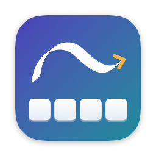

<p align="center">
  
</p>

<h1 align="center">Ductus</h1>

<p align="center">A free, open source typing tutor for macOS, built for learning a new keyboard layout.</p>

Ductus adapts every drill to your weak keys as you type, unlocks new letters when you are ready for them, and shows an on-screen keyboard that follows your layout and lights up as you press keys. It works for Dvorak, Colemak, AZERTY, QWERTZ and any other layout installed on your Mac, in twenty-one languages. Everything runs on your Mac: No accounts, no telemetry, no internet needed.

The name comes from calligraphy: The ductus is the order, direction and rhythm of the strokes that form a letter. That is muscle memory, which is what Ductus trains.

## Features

### Practice that adapts to you

- Every keystroke updates speed and accuracy stats for each key and each pair of letters (like `th` or `ue`).
- Drills lean toward your weakest keys and letter pairs, with a focus key that changes as you improve.
- You start on your layout's home row and unlock the next letter once every current key reaches your targets (35 WPM and 95% accuracy by default, adjustable in Settings).
- Drills use only real words and real sentences from books, never made-up letter strings.
- Each session starts with a short warm-up on keys you have already mastered.

### Four tabs

- **Practice:** Adaptive word drills, or real sentences once you have unlocked enough letters.
- **Race:** Timed races of 30 seconds to 5 minutes against your own best, with all letters, unlocked letters only, or real sentences. Afterward you see the keys that cost you the most.
- **Text:** Paste your own text (an article, a book chapter, some code) and type through it part by part. Ductus remembers where you left off. Code and poems can keep their line breaks. Text in any of the twenty-one languages works too.
- **History:** Speed and accuracy over time, a heatmap of your weak keys, trends for each key, your unlock timeline, race records and your own texts.

### An on-screen keyboard that follows your layout

- Reads your active layout from macOS, so every key shows what it really types. No layouts are built in, except Korean 2-Set, which macOS does not describe.
- Outlines the next key to press, plus Shift, Option or the accent key when a character needs them.
- Shows ANSI, ISO and JIS keyboards, detected from the keyboard you type on.
- Handles "Dvorak - QWERTY ⌘": While you hold Command, keys show their QWERTY shortcuts, and the shortcut keys (Z X C V by default, your choice) glow soft yellow.
- Faint QWERTY letters in the corner of each key show what is printed on your real keyboard.
- Docked in the window, or popped out as a floating keyboard with the drill text and live stats above it. Adjustable opacity, optional click-through, light and dark appearance.
- Fades keys you have mastered, so you look down less.
- Optionally colors each key by the finger that presses it (pinky, ring, middle, index, thumb), like a typing chart.
- Optionally lights up while you type in other apps (opt-in, needs the Input Monitoring permission).

### Options

- Stop on a mistake, or keep going and fix it with Backspace.
- Capitals and punctuation in drills.
- Text size, a daily practice goal, and key click and mistake sounds.
- The app itself in English, French, Spanish, German, Italian, Portuguese, Dutch, Turkish, Polish, Czech, Hungarian, Greek, Russian, Ukrainian, Hebrew, Arabic, Persian, Hindi, Japanese, Chinese or Korean. It follows your macOS language, or pick one in Settings. These translations were made with AI and may not be completely accurate; corrections are welcome.
- A hidden debug mode (hold Option while opening Settings).

### Updates

- Ductus › Check for Updates… (or Settings › Updates) checks GitHub for a newer version and shows what changed.
- You decide: Download and Install fetches the update, checks it against the release's checksums, then Ductus closes and opens again as the new version. Your progress and settings are kept. Nothing is downloaded or installed until you click.
- Optional automatic checks, at most once a day, only tell you an update exists.
- Keep Ductus in your Applications folder for updates to work (macOS does not let apps update themselves while they run from Downloads).
- If you use typing in other apps, macOS asks for the Input Monitoring permission again after each update until Ductus is notarized by Apple.

### Progress

- Saved on your Mac, separately for each keyboard layout and language.
- Export your history as a CSV file, or reset a layout and start over.

## Languages

| Language | What you type | Where the text comes from |
|---|---|---|
| English, French, Spanish, German, Italian, Portuguese, Dutch | The words as written, including accents. Dead keys work (´ then e makes é). | Public-domain books on Project Gutenberg |
| Turkish, Polish, Czech, Hungarian, Greek Ελληνικά, Russian Русский, Ukrainian Українська | The words as written, including accents and special letters. | Tatoeba |
| Hindi हिन्दी | The words as written, on a Devanagari layout (InScript or Devanagari QWERTY). Each key counts on its own: कि is क then the vowel sign ि. | Tatoeba |
| Hebrew עברית, Persian فارسی | The words as written, without vowel marks. Text runs right to left. | Tatoeba |
| Arabic العربية | The words as written, without short vowel marks, on any Arabic layout (Arabic, Arabic PC, Arabic QWERTY). Modern Standard and Egyptian Arabic. Text runs right to left. | Tatoeba |
| Japanese 日本語 | Romaji, the way you would type into the Japanese input method (`nihongo`), with the Japanese shown above | Tatoeba |
| Chinese 中文 | Pinyin without tones, v for ü (`zhongwen`), with the Chinese shown above | Tatoeba |
| Korean 한국어 | Hangul on the 2-Set (Dubeolsik) layout. Syllable blocks fill in as you type their keys. | Tatoeba |

Ductus follows your keyboard. Switch to a French layout and practice switches to French; switch to the Japanese, Chinese or Korean input method and practice follows. Each layout and language keeps its own progress, so switching never mixes them up. You can also pick a language yourself in Settings, for example to practice Spanish on Dvorak.

Every language comes with up to 20,000 real sentences and 10,000 common words. Only letters your layout can actually type are ever unlocked.

## Privacy

- Nothing about you leaves your Mac. There are no accounts and no analytics.
- The only time Ductus goes online is to check GitHub for a newer version: when you choose Check for Updates, or once a day if you turn on automatic checks (off by default). Updates are only downloaded and installed when you click Download and Install.
- Your keystrokes are never written to disk. Only the stats built from them (speed and accuracy per key) are saved.
- Highlighting keys in other apps is off by default, needs your permission, and keeps nothing.
- Texts you paste into the Text tab are saved only on your Mac.

## Getting Ductus

Download the latest version from [Releases](https://github.com/Daggenthal/Ductus/releases). It runs on Apple Silicon and Intel Macs with macOS 14 or newer.

- **Ductus-x.y.z.dmg:** Open it and drag Ductus into Applications.
- **Ductus-x.y.z.zip:** Unzip it and move Ductus into Applications.

Ductus is not notarized by Apple yet (that needs a paid developer account), so macOS blocks it the first time you open it:

1. Open Ductus. macOS says it cannot verify the developer. Click **Done**.
2. Open **System Settings › Privacy & Security**, scroll down, and click **Open Anyway** next to the message about Ductus.
3. Confirm with **Open**. From then on Ductus opens normally.

You can also build it yourself from the source (see below).

## Made with AI

Ductus was developed with the assistance of AI: Claude, made by [Anthropic](https://www.anthropic.com), working in [Claude Code](https://claude.com/claude-code). Claude wrote most of the code, tests and build scripts. The author designed the features, tested every change on a real keyboard, and made the calls on what to build and what to leave out.

The app itself has no AI in it. We tested small on-device models for writing drills and found that real sentences from people read better, so Ductus uses only those.

## Credits

- Words and sentences in English, French, Spanish, German, Italian, Portuguese and Dutch: public-domain books from [Project Gutenberg](https://www.gutenberg.org).
- Sentences in every other language: the contributors of [Tatoeba](https://tatoeba.org), under [CC BY 2.0 FR](https://creativecommons.org/licenses/by/2.0/fr/). Every sentence's author is listed in the app (About Ductus, Sentence Authors) and in the `*-credits.tsv` files.
- Tools used only to build the word lists: fugashi and unidic-lite, jieba, pypinyin and OpenCC.
- Swear words are left out using the [List of Dirty, Naughty, Obscene, and Otherwise Bad Words](https://github.com/LDNOOBW/List-of-Dirty-Naughty-Obscene-and-Otherwise-Bad-Words) (CC BY 4.0), used only when building the word lists.
- The adaptive approach was inspired by [keybr.com](https://www.keybr.com). No code from it is used.

[CORPUS.md](CORPUS.md) lists every book, source, filter and tool.

## Building and testing

Requires Xcode 16 or newer (Swift 6) and macOS 14 or newer.

Open `Ductus.xcodeproj` and run the Ductus scheme, or from the terminal:

```sh
xcodebuild -project Ductus.xcodeproj -scheme Ductus build
```

To make the downloadable universal app (zip and disk image) on your Mac:

```sh
scripts/package.sh          # writes build/Ductus-<version>.zip, .dmg and SHA256SUMS.txt
```

Pushing a version tag (`git tag v0.1.0 && git push origin v0.1.0`) makes GitHub build the same files and attach them to a draft release.

The engine has its own tests and demo:

```sh
cd DuctusEngine
swift test
swift run ductus-demo            # watch a simulated learner progress (add --qwerty to compare)
```

## Project layout

```
Ductus/                  The Mac app (SwiftUI)
  Keyboard/              Layout reading, on-screen keyboard, floating panel
  Practice/ Race/ Text/  The tabs
  History/ Progress/     Charts and saved progress (SwiftData)
  Assets.xcassets        App icon
DuctusUpdater/           Small helper that swaps in an update and reopens Ductus
DuctusEngine/            Swift package, no UI imports
  Sources/DuctusEngine   Stats, unlocking, drills, languages, word lists and sentences
  Sources/DuctusLog      Colored terminal logger
  Sources/ductus-demo    Simulated learner, shows drills adapting
  Tests/                 Swift Testing suites
scripts/
  build_corpus.py        Word lists and sentences from Gutenberg books
  build_cjk_corpus.py    The Tatoeba languages
  spellcheck.swift       Spell-check filter used by build_corpus.py
  make_icon.swift        Draws the app icon in every size
  package.sh             Builds the universal app, zip and disk image
.github/workflows/       Builds releases on GitHub when a version tag is pushed
```

## Debugging

- `DUCTUS_DEBUG=1` turns on debug logging, or hold Option while opening Settings and turn on Debug mode. Debug mode also writes a log file you can open from Settings. Typed keys are never logged.
- `DUCTUS_NO_COLOR=1` (or `NO_COLOR=1`) turns off colored log output.

## License

MIT. See [LICENSE](LICENSE).
